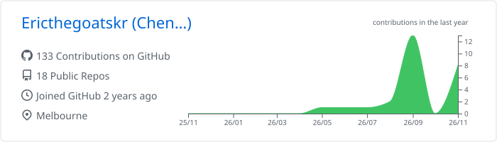
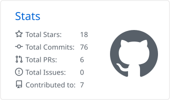
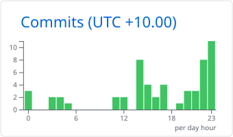
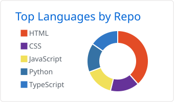
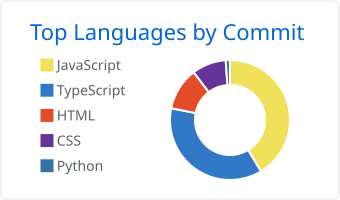

# 👋 Eric Tsai (蔡承諺)

**English** · [繁體中文](README.zh-TW.md)

I’m pursuing a Master of Information Technology at Monash University in Melbourne. My projects focus on public data dashboards and browser applications that use computer vision. I design dashboards that show when data was last updated and which readings were excluded.

I’m originally from Kaohsiung and hold a bachelor’s degree in Information Engineering from I-Shou University. As an IT intern at USI Management Consulting, I worked on YOLO-based image recognition for industrial safety.

## 📌 Selected Projects

| Project | Overview | Live Demo |
| --- | --- | --- |
| [Melbourne Daily](https://github.com/Ericthegoatskr/melbourne-daily) | A Melbourne dashboard for weather, UV, air quality, parking and public transport, with nearby stop search and departure information for trains, trams and buses. | [Open dashboard](https://ericthegoatskr.github.io/melbourne-daily/) |
| [Melbourne Street Parking](https://github.com/Ericthegoatskr/melbourne-parking-dashboard) | A street parking dashboard for the City of Melbourne with search by destination. It shows how recently the council data was updated and excludes sensors that have not reported recently from availability counts. | [Open dashboard](https://ericthegoatskr.github.io/melbourne-parking-dashboard/) |
| [Crunch Lab](https://github.com/Ericthegoatskr/crunch-lab) | An interactive 3D simulation that uses hand tracking to let users squeeze and crack virtual desserts. Built with Three.js, MediaPipe and the Web Audio API. | [Launch demo](https://ericthegoatskr.github.io/crunch-lab/) |
| [Crashout Cam](https://github.com/Ericthegoatskr/crashout-cam) | A computer vision demo that maps facial expressions and hand gestures to meme reactions. All camera frames are processed on the device. | [Launch demo](https://ericthegoatskr.github.io/crashout-cam/) |
| [AquaSync](https://github.com/Ericthegoatskr/AquaSync) | A dashboard for monitoring reservoir storage across Taiwan, with regional filters and open data from Taiwan’s Water Resources Agency. | [Open dashboard](https://ericthegoatskr.github.io/AquaSync/) |
| [BoxScore](https://github.com/Ericthegoatskr/scoreboard) | An offline SwiftUI basketball scoreboard for tracking team scores and individual player stats. | |

**More projects** · [NBA Data Analysis](https://github.com/Ericthegoatskr/NBA-Data-Analysis) · [SkyGazer](https://github.com/Ericthegoatskr/SkyGazer)

## 🛠️ Technical Skills

- **Web & maps** · TypeScript, JavaScript, React, Leaflet
- **Computer vision & graphics** · Three.js, MediaPipe, YOLO
- **Data & mobile** · Python, pandas, SwiftUI
- **Build & testing** · Vite, Vitest, GitHub Actions

## 📫 Contact

I’m interested in graduate and internship opportunities in frontend development and data engineering in Melbourne.

[LinkedIn](https://www.linkedin.com/in/ericthegoat/) · [Email](mailto:tsaieric15@gmail.com) · [Instagram](https://www.instagram.com/loboeric_/)

  
📈 GitHub Stats

   

  <picture>
    <source media="(prefers-color-scheme: dark)" srcset="./profile-summary-card-output/github_dark/0-profile-details.svg">
    <source media="(prefers-color-scheme: light)" srcset="./profile-summary-card-output/github/0-profile-details.svg">
    
  </picture>

  <picture>
    <source media="(prefers-color-scheme: dark)" srcset="./profile-summary-card-output/github_dark/3-stats.svg">
    <source media="(prefers-color-scheme: light)" srcset="./profile-summary-card-output/github/3-stats.svg">
    
  </picture>
  <picture>
    <source media="(prefers-color-scheme: dark)" srcset="./profile-summary-card-output/github_dark/4-productive-time.svg">
    <source media="(prefers-color-scheme: light)" srcset="./profile-summary-card-output/github/4-productive-time.svg">
    
  </picture>

  <picture>
    <source media="(prefers-color-scheme: dark)" srcset="./profile-summary-card-output/github_dark/1-repos-per-language.svg">
    <source media="(prefers-color-scheme: light)" srcset="./profile-summary-card-output/github/1-repos-per-language.svg">
    
  </picture>
  <picture>
    <source media="(prefers-color-scheme: dark)" srcset="./profile-summary-card-output/github_dark/2-most-commit-language.svg">
    <source media="(prefers-color-scheme: light)" srcset="./profile-summary-card-output/github/2-most-commit-language.svg">
    
  </picture>

  Cards are generated by <a href="./.github/workflows/profile-summary-cards.yml">GitHub Actions</a> and stored in this repository.

  

