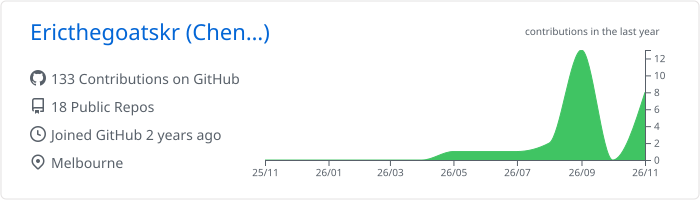
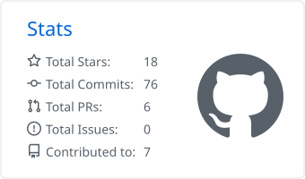
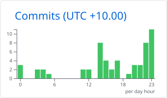
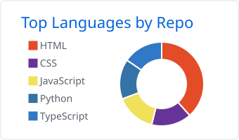
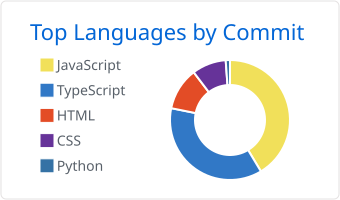

# 👋 蔡承諺 Eric Tsai

[English](README.md) · **繁體中文**

我目前在墨爾本的蒙納許大學攻讀資訊科技碩士。專案主要聚焦於開放資料儀表板與瀏覽器端的電腦視覺應用。我在儀表板上標示資料更新時間與未採計的讀值，方便使用者判斷資料的時效性。

我來自高雄，畢業於義守大學資訊工程學系。曾在台聚管理顧問股份有限公司資訊處實習，運用 YOLO 進行工業安全影像辨識。

## 📌 精選專案

| 專案 | 專案簡介 | 線上體驗 |
| --- | --- | --- |
| [Melbourne Daily](https://github.com/Ericthegoatskr/melbourne-daily) | 整合墨爾本天氣、紫外線、空氣品質、停車與大眾運輸資訊，支援附近火車、電車與公車站點及發車時間查詢。 | [開啟儀表板](https://ericthegoatskr.github.io/melbourne-daily/) |
| [Melbourne Street Parking](https://github.com/Ericthegoatskr/melbourne-parking-dashboard) | 提供墨爾本市路邊停車查詢，可依目的地搜尋附近車位。頁面顯示市政府資料的更新時間，空位統計會排除近期未回報的感測器。 | [開啟儀表板](https://ericthegoatskr.github.io/melbourne-parking-dashboard/) |
| [Crunch Lab](https://github.com/Ericthegoatskr/crunch-lab) | 在瀏覽器中透過手勢操控 3D 甜點的擠壓與碎裂。使用 Three.js 渲染畫面、MediaPipe 追蹤手部，並以 Web Audio API 合成音效。 | [開啟體驗](https://ericthegoatskr.github.io/crunch-lab/) |
| [Crashout Cam](https://github.com/Ericthegoatskr/crashout-cam) | 電腦視覺展示專案，透過臉部表情與手勢觸發不同的迷因反應。相機影像均在使用者裝置上處理。 | [開啟體驗](https://ericthegoatskr.github.io/crashout-cam/) |
| [AquaSync](https://github.com/Ericthegoatskr/AquaSync) | 採用經濟部水利署的開放資料，呈現全台水庫蓄水狀況，並提供地區篩選。 | [開啟儀表板](https://ericthegoatskr.github.io/AquaSync/) |
| [BoxScore](https://github.com/Ericthegoatskr/scoreboard) | 用 SwiftUI 開發的離線籃球計分板，可記錄球隊比分與球員個人數據。 | |

**其他專案** · [NBA Data Analysis](https://github.com/Ericthegoatskr/NBA-Data-Analysis) · [SkyGazer](https://github.com/Ericthegoatskr/SkyGazer)

## 🛠️ 常用技術

- **網頁與地圖** · TypeScript, JavaScript, React, Leaflet
- **電腦視覺與 3D** · Three.js, MediaPipe, YOLO
- **資料與行動端** · Python, pandas, SwiftUI
- **建置與測試** · Vite, Vitest, GitHub Actions

## 📫 聯絡方式

目前正尋找墨爾本地區的前端開發與資料工程應屆畢業生職缺及實習機會。

[LinkedIn](https://www.linkedin.com/in/ericthegoat/) · [Email](mailto:tsaieric15@gmail.com) · [Instagram](https://www.instagram.com/loboeric_/)

  
📈 GitHub 數據

   

  <picture>
    <source media="(prefers-color-scheme: dark)" srcset="./profile-summary-card-output/github_dark/0-profile-details.svg">
    <source media="(prefers-color-scheme: light)" srcset="./profile-summary-card-output/github/0-profile-details.svg">
    
  </picture>

  <picture>
    <source media="(prefers-color-scheme: dark)" srcset="./profile-summary-card-output/github_dark/3-stats.svg">
    <source media="(prefers-color-scheme: light)" srcset="./profile-summary-card-output/github/3-stats.svg">
    
  </picture>
  <picture>
    <source media="(prefers-color-scheme: dark)" srcset="./profile-summary-card-output/github_dark/4-productive-time.svg">
    <source media="(prefers-color-scheme: light)" srcset="./profile-summary-card-output/github/4-productive-time.svg">
    
  </picture>

  <picture>
    <source media="(prefers-color-scheme: dark)" srcset="./profile-summary-card-output/github_dark/1-repos-per-language.svg">
    <source media="(prefers-color-scheme: light)" srcset="./profile-summary-card-output/github/1-repos-per-language.svg">
    
  </picture>
  <picture>
    <source media="(prefers-color-scheme: dark)" srcset="./profile-summary-card-output/github_dark/2-most-commit-language.svg">
    <source media="(prefers-color-scheme: light)" srcset="./profile-summary-card-output/github/2-most-commit-language.svg">
    
  </picture>

  統計卡片由 <a href="./.github/workflows/profile-summary-cards.yml">GitHub Actions</a> 產生並存放於此 repo。

  

